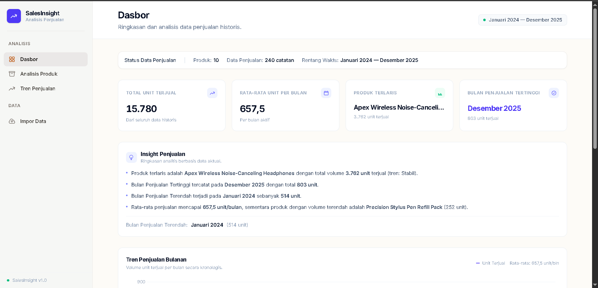
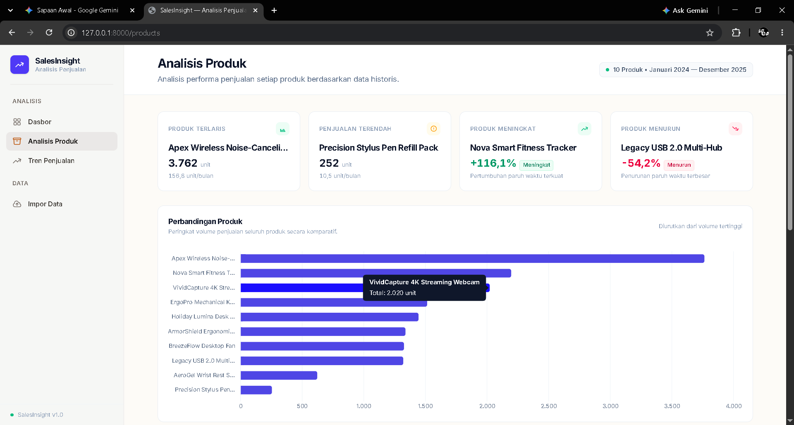
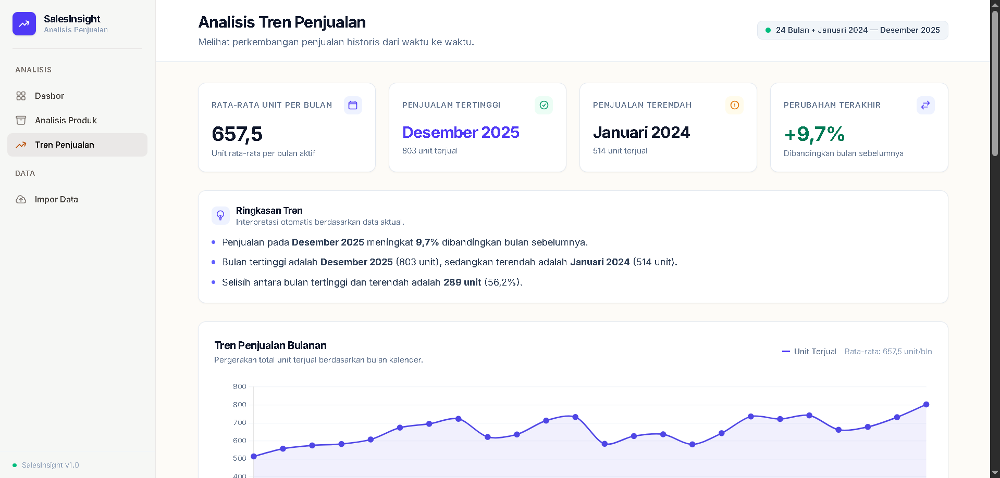
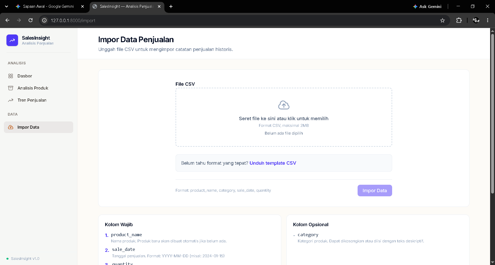

# SalesInsight — Sales Data Analytics

SalesInsight is a web-based sales analytics application designed to help users analyze historical sales data, monitor product performance, and understand monthly sales trends.

The application provides interactive visualizations, sales performance metrics, and CSV data import functionality to make historical sales data easier to explore.

## Features

- **Dashboard** — View key sales metrics, monthly sales trends, top-selling products, and sales insights.
- **Product Analysis** — Compare product performance, identify the highest and lowest performers, and review product trend statuses.
- **Sales Trends** — Analyze monthly sales movements, month-over-month (MoM) changes, and historical sales patterns.
- **CSV Data Import** — Upload sales data using CSV files, download a sample template, validate records, and review row-level import errors.

## Screenshots

### Dashboard



### Product Analysis



### Sales Trends



### CSV Data Import



## Tech Stack

- **Backend:** PHP 8.2+, Laravel 12
- **Frontend:** Laravel Blade, Tailwind CSS v4
- **Charts:** Chart.js 4.5.1
- **Database:** SQLite
- **Build Tool:** Vite

## System Architecture

SalesInsight uses Laravel's server-rendered architecture with the following request flow:

`Route → Controller → Service → Blade View`

The main services include:

- `SalesMetricsService` — Calculates key performance indicators and sales totals.
- `ProductPerformanceService` — Analyzes product performance, rankings, and trend statuses.
- `TrendAnalysisService` — Calculates month-over-month changes and monthly sales statistics.
- `SalesImportService` — Handles CSV parsing, row validation, and database transactions during data import.

## Project Structure

```text
sales-insight/
├── app/
│   ├── Http/
│   │   ├── Controllers/
│   │   └── ...
│   └── Services/
├── bootstrap/
├── config/
├── database/
├── public/
├── resources/
│   ├── css/
│   ├── js/
│   └── views/
├── routes/
├── screenshots/
│   ├── 01-dashboard.png
│   ├── 02-products.png
│   ├── 03-trends.png
│   └── 04-import.png
├── tests/
├── .env.example
├── artisan
├── composer.json
├── package.json
└── vite.config.js
```

## Requirements

- PHP 8.2 or newer
- Composer
- Node.js and npm
- SQLite with the required PHP extensions

## Installation and Setup

1. Clone the repository:

   ```bash
   git clone https://github.com/amrullah-dev/sales-insight.git
   cd sales-insight
   ```

2. Install PHP dependencies:

   ```bash
   composer install
   ```

3. Create your environment file:

   ```bash
   copy .env.example .env
   ```

   Configure the environment and database settings in `.env` according to your local setup.

4. Generate the application key:

   ```bash
   php artisan key:generate
   ```

5. Create the SQLite database file if it does not exist, then run migrations:

   ```bash
   php artisan migrate
   ```

6. Install frontend dependencies and build assets:

   ```bash
   npm install
   npm run build
   ```

7. Start the Laravel development server:

   ```bash
   php artisan serve
   ```

8. Open the local URL displayed in your terminal.

## Development

To run the Vite development server while working on the frontend:

```bash
npm run dev
```

## Repository

GitHub: https://github.com/amrullah-dev/sales-insight

